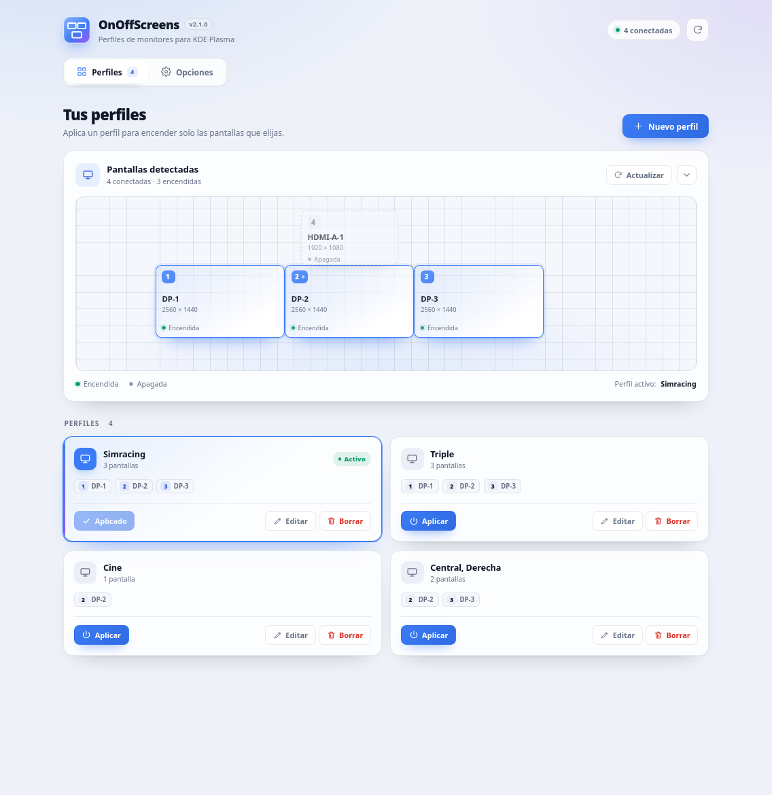

# OnOffScreens — perfiles de monitores para KDE Plasma

> English: [README.md](README.md)

Aplicación de escritorio **OnOffScreens**, escrita en **Rust + Tauri 2** para encender y apagar monitores por
perfiles. Detecta las pantallas y su distribución, las muestra en un mapa
interactivo y permite aplicar un perfil desde la ventana o desde el icono de la
bandeja del sistema. Se distribuye como dos **AppImages**: full y portable.

La versión anterior en Python se conserva en [`legacy/`](legacy/) y sus perfiles
se importan automáticamente la primera vez.



---

## Funciones

- **Detección automática** de pantallas y su disposición real (posición y
  tamaño), con un mapa visual numerado para saber de un vistazo cuál es cuál.
- **Perfiles por UUID de monitor**: siguen funcionando si cambias un cable de
  puerto, reinicias o reinstalas el sistema. Puedes seleccionar las pantallas
  haciendo clic en el mapa o en la lista.
- **Ventana con dos pestañas**: *Perfiles* y *Opciones*.
- **Crear, editar, aplicar y borrar perfiles** desde la ventana. El perfil
  aplicado queda resaltado con una insignia *Activo*.
- **Bandeja del sistema** con la lista de perfiles (el activo marcado), acceso a
  las pantallas detectadas, una acción **Reconfigurar pantallas** para recuperar
  la imagen, configuración de pantallas de KDE y salida.
- **Arranque automático** con la sesión, activable desde *Opciones*.
- **Icono de bandeja incluido dentro del binario/AppImage**: no depende de
  archivos de iconos instalados en el sistema.
- **CLI** para scripts y atajos de teclado.
- **Español, catalán e inglés**, detectados del locale del sistema (variantes
  del español en español, variantes del catalán en catalán e inglés en el resto)
  o elegidos en *Opciones → Idioma*.
- Numeración estable por EDID y recolocación sin huecos al apagar pantallas.

---

## Requisitos

| Qué | Paquete |
|---|---|
| Escritorio | **KDE Plasma 5.27+ / 6.x** (Wayland o X11) |
| Detección y aplicación | `kscreen` (`kscreen-doctor`) |
| Interfaz | `webkit2gtk-4.1`, `gtk3` (incluidas en la full; necesarias para la portable) |
| Bandeja | `libayatana-appindicator` (incluida en ambas AppImages) |
| Opcional | `notify-send` para avisos |

La versión **full** incluye la aplicación, la interfaz (GTK y WebKitGTK) y las
librerías de la bandeja: solo depende de las librerías base del sistema (glibc,
controladores gráficos) y de `kscreen` en KDE. La versión **portable/ligera**
usa GTK y WebKitGTK del sistema e incluye la bandeja; ocupa mucho menos y está
pensada para equipos actualizados. Ambas funcionan en **Arch, Ubuntu LTS actual
y Fedora** y sus derivadas.

> Solo funciona en KDE Plasma porque utiliza `kscreen-doctor`. En otros
> escritorios (GNOME, niri, sway…) la ventana y los ajustes abren, pero no hay
> backend de pantallas.

---

## Uso de la AppImage

Hay dos versiones:

| Versión | Tamaño | Para qué |
|---|---|---|
| `OnOffScreens_2.1.0_amd64-full.AppImage` | ~78 MB | Cualquier distro; incluye WebKitGTK y GTK |
| `OnOffScreens_2.1.0_amd64-portable.AppImage` | ~3,3 MB | Arch/CachyOS y sistemas actualizados; usa las librerías del sistema |

La **portable** necesita `webkit2gtk-4.1` y `gtk3` instalados:

```bash
# Arch / CachyOS
sudo pacman -S webkit2gtk-4.1 gtk3
# Ubuntu / Debian
sudo apt install libwebkit2gtk-4.1-0 libgtk-3-0
# Fedora
sudo dnf install webkit2gtk4.1 gtk3
```

Descarga la que prefieras, dale permisos y ejecútala:

```bash
chmod +x OnOffScreens_2.1.0_amd64-full.AppImage
./OnOffScreens_2.1.0_amd64-full.AppImage
```

- **Menú de aplicaciones**: si quieres integrarla, usa AppImageLauncher,
  Gearlever o crea un lanzador. No es necesario para usarla.
- **Arranque automático**: la opción de *Opciones* crea
  `~/.config/autostart/onoffscreens.desktop` apuntando a la ruta actual de la
  AppImage. Si mueves el archivo, vuelve a abrirlo una vez y la entrada se
  actualiza sola.
- **Bandeja al iniciar**: si el arranque automático está activo y la bandeja
  también, la app se inicia oculta y deja solo el icono. Al cerrar la ventana
  con la bandeja activa, la app sigue en la bandeja; usa *Salir* en su menú.
- **Sin FUSE** (Ubuntu 24.04 no trae `libfuse2` por defecto): instala
  `libfuse2t64` o ejecuta
  `./OnOffScreens_2.1.0_amd64-full.AppImage --appimage-extract-and-run`.

### Compatibilidad

Las dos AppImages se compilan en **Ubuntu 22.04** (glibc 2.35) para que
funcionen también en Ubuntu 24.04, Arch, Fedora y derivadas. La **portable**
necesita además `webkit2gtk-4.1` y `gtk3` del sistema; la **full** no. Compilar
en un sistema más nuevo produce una AppImage que puede no arrancar en Ubuntu
LTS; usa el flujo de GitHub Actions o un contenedor Ubuntu 22.04 para publicar.

---

## Uso

### Ventana

1. **Perfiles** muestra el mapa de pantallas, su estado y tus perfiles.
2. **Nuevo perfil** abre un popup con la distribución; selecciona pantallas,
   ponle nombre y guarda.
3. Cada perfil tiene **Aplicar**, **Editar** y **Borrar**.
4. **Opciones** permite activar el arranque automático y el icono de bandeja
   (activado por defecto). También incluye reconfigurar las pantallas, reasignar
   la numeración, abrir la configuración de pantallas de KDE y la carpeta de
   datos de OnOffScreens.

### Línea de comandos

```bash
./OnOffScreens_2.1.0_amd64-full.AppImage                 # abre la ventana
./OnOffScreens_2.1.0_amd64-full.AppImage --tray          # inicia solo en la bandeja
./OnOffScreens_2.1.0_amd64-full.AppImage --list          # lista perfiles
./OnOffScreens_2.1.0_amd64-full.AppImage --apply "Cine"  # aplica por nombre
./OnOffScreens_2.1.0_amd64-full.AppImage --apply 2       # aplica por número
./OnOffScreens_2.1.0_amd64-full.AppImage --status        # pantallas detectadas
./OnOffScreens_2.1.0_amd64-full.AppImage --renumber      # recalcula la numeración
```

---

## Datos y migración

| Qué | Dónde |
|---|---|
| Perfiles | `~/.config/onoffscreens/perfiles.json` |
| Ajustes | `~/.config/onoffscreens/config.json` |
| Mapa de pantallas | `~/.local/state/onoffscreens/mapa.json` |
| Autostart | `~/.config/autostart/onoffscreens.desktop` |

La primera vez que se abre, si existe el antiguo
`~/.config/pantallas/perfiles.conf`, se importa a `perfiles.json`; el `.conf`
no se borra. Los números del formato antiguo se resuelven con el mapa estable y
se convierten a UUID de monitor.

Si ya usabas la versión anterior de OnOffScreens cuando todavía se llamaba
`pantallas`, las carpetas `~/.config/pantallas` y `~/.local/state/pantallas` se
copian automáticamente a `~/.config/onoffscreens` y
`~/.local/state/onoffscreens` la primera vez. Los datos originales no se borran.

Si la versión antigua tenía el arranque automático activo
(`pantallas-tray.desktop`), se conserva esa elección creando la entrada nueva y
eliminando la vieja. El lanzador del menú de la versión Python no se toca: si
lo tenías instalado, puedes quitarlo con `pantallas-desinstalar`. Si el icono
antiguo sigue en la bandeja hasta cerrar sesión, puedes terminar su proceso con
`pkill -f "bin/pantallas tray"`.

### Perfiles

Los perfiles se guardan por **UUID del monitor**, no por número ni por nombre
de salida. Así el mismo perfil funciona aunque el monitor cambie de puerto.

- Pantallas nuevas reciben el siguiente número libre, por posición.
- Los números no cambian entre reinicios.
- **Reasignar numeración** recalcula los números según la distribución actual.
  Enciende todas las pantallas antes de usarlo.
- Al aplicar un perfil se apagan las pantallas no elegidas y se recolocan las
  que quedan **sin huecos**, manteniendo las filas (la de arriba sigue arriba).

---

## Compilar

Requisitos generales: Node.js 20+, Rust estable y las dependencias de Tauri 2.

**Arch / CachyOS**

```bash
sudo pacman -S --needed base-devel curl wget file openssl nodejs npm rust \
  webkit2gtk-4.1 gtk3 libayatana-appindicator librsvg
```

**Ubuntu 24.04**

```bash
sudo apt install build-essential curl wget file libssl-dev \
  libwebkit2gtk-4.1-dev libayatana-appindicator3-dev librsvg2-dev libxdo-dev patchelf
```

**Fedora**

```bash
sudo dnf install gcc-c++ make curl wget file openssl-devel \
  webkit2gtk4.1-devel libappindicator-gtk3-devel librsvg2-devel patchelf
```

Después:

```bash
npm install
npm run tauri dev       # desarrollo
npm run appimage        # genera las AppImages full y portable en release/
```

Para trabajar en la interfaz sin KDE puedes usar el backend simulado (solo en
compilaciones de desarrollo):

```bash
ONOFFSCREENS_MOCK=1 npm run tauri dev
```

`npm run appimage` genera la AppImage full con Tauri y deriva la portable con
`scripts/package-appimages.sh`. La release automática se construye con
[`.github/workflows/build-appimage.yml`](.github/workflows/build-appimage.yml),
que genera las dos versiones al publicar un tag `v*`.

---

## Idioma

Por defecto sigue el locale del sistema (`ONOFFSCREENS_IDIOMA`, `LANGUAGE`,
`LC_ALL`, `LC_MESSAGES` o `LANG`): las variantes del español usan español, las
del catalán usan catalán y el resto usa inglés. Puedes cambiarlo en
*Opciones → Idioma* (*Automático*, *Español*, *Català*, *English*) o con una
variable de entorno:

```bash
ONOFFSCREENS_IDIOMA=ca ./OnOffScreens_2.1.0_amd64-full.AppImage
```

---

## Estructura del proyecto

```
src/                  interfaz React + TypeScript
src-tauri/            backend Rust (kscreen, perfiles, bandeja, autostart)
src-tauri/icons/      iconos de app y bandeja (incluidos en el binario)
release/              AppImages full y portable + SHA-256
legacy/               versión Python original + instaladores
.github/workflows/    compilación de la AppImage
CHANGELOG.md          historial de versiones
```

---

## Problemas típicos

- **No veo el icono de bandeja**: en Plasma los iconos nuevos aparecen en la
  zona oculta (`^`). Clic derecho en la bandeja → *Configurar bandeja del
  sistema…* → *Entradas* → *OnOffScreens* → *Siempre visible*.
- **“No se pudieron detectar las pantallas”**: instala `kscreen` y comprueba
  que estás en una sesión Plasma con `kscreen-doctor -j` funcionando.
- **La AppImage portable no arranca**: instala `webkit2gtk-4.1` y `gtk3`, o usa
  la full. Si no tienes FUSE, usa `--appimage-extract-and-run`.
- **Los números no cuadran tras cambiar monitores**: enciende todas las
  pantallas y usa *Opciones → Reasignar numeración*.
- **Un perfil no enciende una pantalla**: esa pantalla no está conectada. Los
  perfiles guardan UUIDs; al reconectar el mismo monitor vuelve a funcionar.
- **La bandeja no aparece**: revisa que `libayatana-appindicator` esté
  instalado y vuelve a activar la opción en *Opciones*.
- **Colores raros o `Modeset failed` en el journal al iniciar sesión**: KDE está
  restaurando una configuración con HDR y/o una frecuencia alta; OnOffScreens no
  cambia modos ni HDR. Aplicar un perfil fuerza una reconfiguración y suele
  recuperar la imagen. Si ocurre en cada inicio, baja la frecuencia o desactiva
  HDR para esas pantallas en la configuración de pantallas de KDE.

---

## Licencia

**0BSD** — ver [LICENSE](LICENSE). Sin condiciones: úsalo, modifícalo y
redistribúyelo para lo que quieras.
