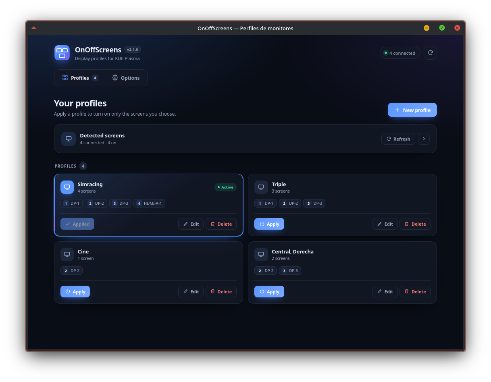
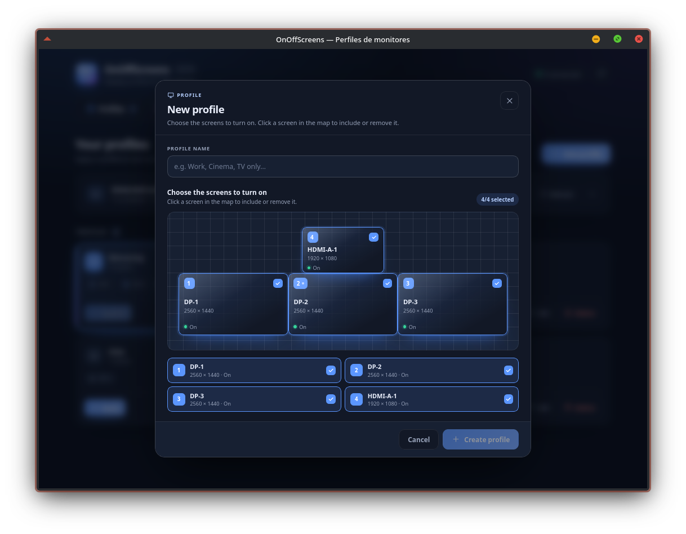
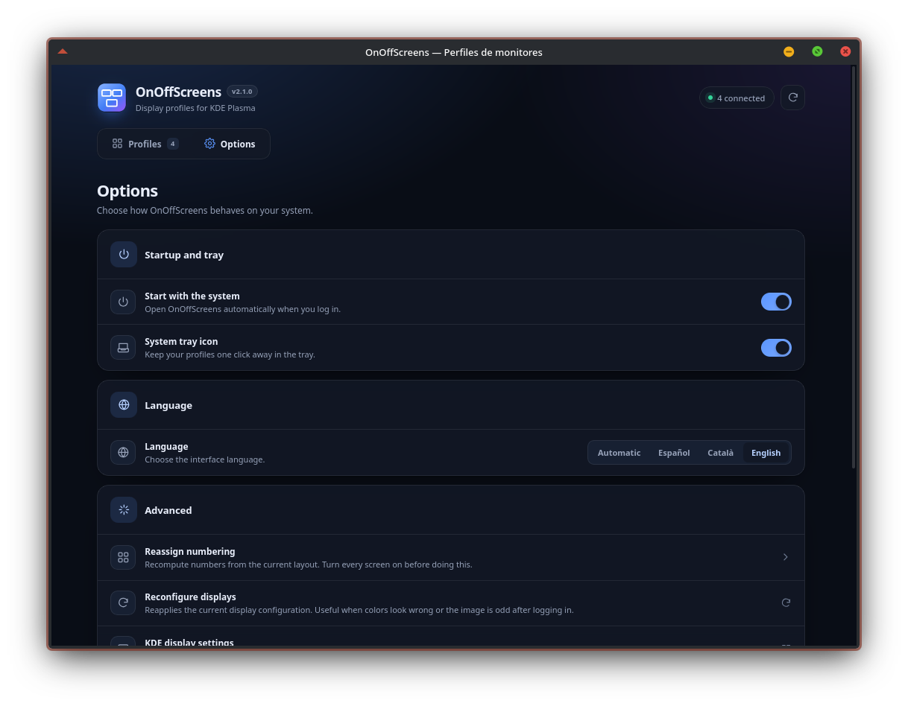
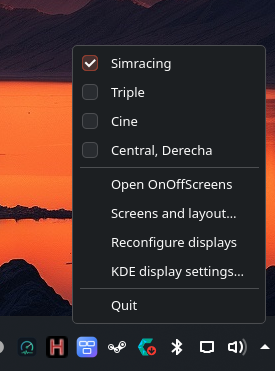

# OnOffScreens

[English](README.md) · **Español** · [Historial de cambios](CHANGELOG.md)

[](https://github.com/pabeernosmatao/OnOffScreens/releases)
[](LICENSE)
[](#requisitos)
[](https://tauri.app)
[](https://kde.org/es/plasma-desktop/)

> **Proyecto personal — probado en KDE Plasma 6 (Wayland) con cuatro pantallas.**
> OnOffScreens depende de `kscreen-doctor` de KDE. Puede funcionar en otras
> configuraciones, pero solo puedo probar lo que tengo. Los informes de fallos y
> los parches son bienvenidos.

**Perfiles de monitores para KDE Plasma, desde la ventana o la bandeja del sistema.**

OnOffScreens es una pequeña aplicación **Rust + Tauri 2** distribuida como
**AppImage**. Detecta tus monitores, muestra su distribución real y los enciende o
apaga por grupos («perfiles») para cambiar entre los perfiles que tengas creados
con un clic, sin desenchufar cables.



*Pestaña Perfiles: pantallas detectadas, perfiles guardados y el activo resaltado.*

---

## Qué hace la AppImage

- **Detecta las pantallas conectadas** y su posición y tamaño reales mediante
  KScreen de KDE (`kscreen-doctor`), y dibuja un mapa numerado para saber de un
  vistazo qué monitor es cuál.
- **Guarda los perfiles por UUID del monitor**, no por puerto ni por nombre, así
  que un perfil sigue funcionando si cambias un cable o reinstalas el sistema.
- **Enciende y apaga pantallas por perfil.** Las que no están seleccionadas se
  apagan y las que quedan se recolocan sin huecos, manteniendo las filas.
- **Ventana, bandeja del sistema y CLI** para los mismos perfiles. El menú de la
  bandeja marca el último perfil aplicado y permite aplicar cualquier otro.
- **Arranque automático con la sesión**, empezando oculta en la bandeja si quieres.
- Acción **Reconfigurar pantallas** para recuperar la imagen cuando KDE arranca
  con colores raros o una imagen extraña tras iniciar sesión.
- **Español, catalán e inglés**, automático o seleccionable.
- **AppImage de un solo archivo:** sin instalación y sin root. Los perfiles y
  ajustes se guardan en tu carpeta personal.
- **Sin telemetría, sin cuentas y sin acceso a la red.**

> OnOffScreens **no** elige resoluciones, frecuencias, escala, rotación ni HDR.
> Solo enciende/apaga salidas y las mueve; KDE conserva la configuración de
> pantallas que hayas definido en Plasma.

## Solo para KDE Plasma

OnOffScreens se comunica con **KDE Plasma** mediante `kscreen-doctor`, del paquete
`kscreen`. Necesita **KDE Plasma 5.27+ o 6.x**, tanto en Wayland como en X11.

En GNOME, XFCE, sway, niri y escritorios similares la ventana se abre, pero no hay
backend de pantallas: no puede detectar ni aplicar perfiles. No está disponible
para Windows ni macOS.

El icono de la bandeja usa StatusNotifierItem/AppIndicator. Plasma lo soporta de
forma nativa; en otros escritorios necesitas una bandeja compatible (por ejemplo,
GNOME con la extensión AppIndicator).

## Capturas

### Crear y editar perfiles



*Elige las pantallas que quieres encender pulsando el mapa o la lista.*

### Opciones



*Arranque automático, bandeja, idioma, reconfigurar pantallas y acciones avanzadas.*

### Bandeja del sistema



*La bandeja deja todos los perfiles a un clic, incluida la acción de recuperación.*

## Descargar y ejecutar

Descarga la última AppImage desde
[Releases](https://github.com/pabeernosmatao/OnOffScreens/releases/latest), dale
permisos de ejecución y arráncala:

```bash
chmod +x OnOffScreens_2.1.0_amd64-full.AppImage
./OnOffScreens_2.1.0_amd64-full.AppImage
```

Se publican dos versiones, ambas **x86_64**:

| Versión | Tamaño | Librerías | Recomendada para |
|---|---|---|---|
| `OnOffScreens_2.1.0_amd64-full.AppImage` | ~80 MB | Incluye GTK, WebKitGTK y la bandeja | Cualquier distro; la opción segura |
| `OnOffScreens_2.1.0_amd64-portable.AppImage` | ~3,3 MB | Usa GTK/WebKitGTK del sistema; incluye la bandeja | Arch/CachyOS y sistemas actualizados |

Las releases oficiales se compilan en **Ubuntu 22.04**, así que necesitan como
máximo **glibc 2.35**. Si compilas las AppImages localmente en una distro más
nueva, pueden no arrancar en sistemas más antiguos.

La portable necesita `webkit2gtk-4.1` y `gtk3`:

```bash
# Arch / CachyOS
sudo pacman -S webkit2gtk-4.1 gtk3

# Ubuntu / Debian
sudo apt install libwebkit2gtk-4.1-0 libgtk-3-0

# Fedora
sudo dnf install webkit2gtk4.1 gtk3
```

Si tu sistema no tiene FUSE2 (Ubuntu 24.04 por defecto):

```bash
sudo apt install libfuse2t64
# o
./OnOffScreens_2.1.0_amd64-full.AppImage --appimage-extract-and-run
```

AppImageLauncher, Gearlever y herramientas similares son opcionales; solo integran
la AppImage en el menú de aplicaciones.

Verifica la descarga:

```bash
sha256sum -c OnOffScreens_2.1.0_amd64-full.AppImage.sha256
```

## Requisitos

| Qué | Para qué |
|---|---|
| **KDE Plasma 5.27+ / 6.x** con `kscreen` | Detectar y aplicar perfiles |
| Linux **x86_64**, glibc 2.35+ | Ejecutar las AppImages oficiales |
| `webkit2gtk-4.1` y `gtk3` | Solo la versión portable |
| Bandeja StatusNotifierItem/AppIndicator | El icono de la bandeja (nativo en Plasma) |
| `notify-send` (opcional) | Avisos de escritorio |
| `libayatana-appindicator` | Incluida en ambas AppImages |

No hace falta root para ejecutar OnOffScreens.

## Cómo se usa

### Ventana

1. **Perfiles** muestra las pantallas detectadas, su distribución y tus perfiles.
2. **Nuevo perfil** abre el editor; selecciona las pantallas que quieres encender,
   ponle nombre y guarda.
3. Cada perfil tiene **Aplicar**, **Editar** y **Borrar**. El activo queda
   resaltado con la insignia **Activo**.
4. **Opciones** controla el arranque automático, la bandeja, el idioma,
   reconfigurar pantallas, la numeración, la configuración de pantallas de KDE y
   la carpeta de configuración.

Al aplicar un perfil:
- Se encienden las pantallas del perfil.
- Se apagan las conectadas que no están en él.
- Las que quedan se recolocan sin huecos, manteniendo las filas.

Solo se envían a KDE los cambios que realmente hacen falta. Aplicar un perfil que
ya coincide con la distribución actual no vuelve a reconfigurar las pantallas.

### Bandeja del sistema

El menú de la bandeja contiene:

- Tus perfiles, con el último aplicado marcado.
- **Abrir OnOffScreens**.
- **Pantallas y distribución…**.
- **Reconfigurar pantallas**.
- **Configuración de pantallas de KDE…**.
- **Salir**.

Si el icono de bandeja está activado, cerrar la ventana mantiene OnOffScreens en la
bandeja. Usa **Salir** para terminar.

### Reconfigurar pantallas

Usa **Opciones → Avanzado → Reconfigurar pantallas** (o la entrada de la bandeja)
cuando la imagen o los colores se vean mal tras iniciar sesión. Pide a KDE que
vuelva a aplicar las salidas encendidas actuales. La pantalla puede parpadear un
momento; no cambia tu perfil activo.

Es la forma más rápida de recuperarse cuando KDE arranca con una configuración
HDR/alta frecuencia que no se aplicó bien. Si ocurre en cada inicio, baja la
frecuencia o desactiva HDR para esas salidas en la configuración de pantallas de
KDE.

### Arrancar con la sesión

Activa **Iniciar con el sistema** en *Opciones*. Se crea la entrada
`~/.config/autostart/onoffscreens.desktop` apuntando a la AppImage actual. Si mueves
la AppImage, ábrela una vez y la ruta se actualiza sola.

Con arranque automático y bandeja activados, la app se inicia oculta y solo
aparece el icono. Mientras siga en la bandeja no se consultan las pantallas; el
estado se lee al abrir la ventana o al ejecutar una acción.

### CLI

```bash
./OnOffScreens_2.1.0_amd64-full.AppImage                 # abre la ventana
./OnOffScreens_2.1.0_amd64-full.AppImage --tray          # inicia solo en la bandeja
./OnOffScreens_2.1.0_amd64-full.AppImage --list          # lista perfiles
./OnOffScreens_2.1.0_amd64-full.AppImage --apply "Trabajo"  # aplica por nombre
./OnOffScreens_2.1.0_amd64-full.AppImage --apply 2       # aplica por índice
./OnOffScreens_2.1.0_amd64-full.AppImage --status        # pantallas detectadas
./OnOffScreens_2.1.0_amd64-full.AppImage --renumber      # recalcula la numeración
```

## Perfiles y datos

Los perfiles se guardan por **UUID del monitor**, así que el mismo perfil funciona
aunque cambies un monitor de puerto. Las pantallas nuevas reciben el siguiente
número libre por posición y los números sobreviven a los reinicios.

**Reasignar numeración** recalcula los números según la distribución actual.
Enciende todas las pantallas antes de usarlo.

| Qué | Dónde |
|---|---|
| Perfiles | `~/.config/onoffscreens/perfiles.json` |
| Ajustes | `~/.config/onoffscreens/config.json` |
| Mapa de pantallas | `~/.local/state/onoffscreens/mapa.json` |
| Autostart | `~/.config/autostart/onoffscreens.desktop` |

Si usabas la versión antigua en Python (o el nombre anterior `pantallas`), sus
datos se migran en el primer arranque y los archivos originales no se borran.

## Idiomas

La interfaz está disponible en **español, catalán e inglés**.

- **Automático** sigue el locale del sistema: las variantes del español (`es_*`)
  usan español, las del catalán (`ca_*`) usan catalán y el resto usa inglés.
- Puedes forzar el idioma en **Opciones → Idioma**.
- Para scripts o pruebas, `ONOFFSCREENS_IDIOMA` sigue teniendo prioridad:

```bash
ONOFFSCREENS_IDIOMA=ca ./OnOffScreens_2.1.0_amd64-full.AppImage
```

## Problemas típicos

- **No veo el icono de bandeja:** en Plasma los iconos nuevos aparecen en la zona
  oculta (`^`). Clic derecho en la bandeja → *Configurar bandeja del sistema…* →
  *Entradas* → *OnOffScreens* → *Siempre visible*.
- **«No se pudieron detectar las pantallas»:** instala `kscreen` y comprueba que
  `kscreen-doctor -j` funciona en tu sesión Plasma.
- **La AppImage portable no arranca:** instala `webkit2gtk-4.1` y `gtk3`, o usa la
  full. Sin FUSE, ejecútala con `--appimage-extract-and-run`.
- **Los números no cuadran tras cambiar monitores:** enciende todas las pantallas
  y usa *Opciones → Reasignar numeración*.
- **Un perfil no enciende una pantalla:** esa pantalla no está conectada. Los
  perfiles guardan UUIDs, así que vuelve a funcionar al reconectar el monitor.
- **Colores raros o `Modeset failed` en el journal al iniciar sesión:** KDE está
  restaurando una configuración con HDR y/o una frecuencia alta; OnOffScreens no
  cambia modos ni HDR. Usa **Reconfigurar pantallas** para forzar una
  reaplicación. Si se repite, baja la frecuencia o desactiva HDR para esas salidas
  en KDE.
- **KWin se congela al cambiar de perfil:** la versión 2.1 envía solo los cambios
  necesarios en vez de volver a encender todas las pantallas. Si sigue pasando, el
  bloqueo está en KDE/KWin; la acción de recuperación y las líneas del journal de
  la app ayudan a diagnosticarlo.

Fallos y peticiones:
[github.com/pabeernosmatao/OnOffScreens/issues](https://github.com/pabeernosmatao/OnOffScreens/issues).

## Compilar

Requisitos generales: **Node.js 20+**, **Rust** estable y las dependencias de
Tauri 2.

**Arch / CachyOS**

```bash
sudo pacman -S --needed base-devel curl wget file openssl nodejs npm rust \
  webkit2gtk-4.1 gtk3 libayatana-appindicator librsvg
```

**Ubuntu 24.04**

```bash
sudo apt install build-essential curl wget file libssl-dev \
  libwebkit2gtk-4.1-dev libayatana-appindicator3-dev librsvg2-dev libxdo-dev patchelf
```

**Fedora**

```bash
sudo dnf install gcc-c++ make curl wget file openssl-devel \
  webkit2gtk4.1-devel libappindicator-gtk3-devel librsvg2-devel patchelf
```

Después:

```bash
npm install
npm run tauri dev       # desarrollo
npm run appimage        # genera las AppImages full y portable en release/
```

Para trabajar en la interfaz sin KDE puedes usar el backend simulado (solo en
compilaciones de desarrollo):

```bash
ONOFFSCREENS_MOCK=1 npm run tauri dev
```

`npm run appimage` genera la AppImage full con Tauri y deriva la portable con
[`scripts/package-appimages.sh`](scripts/package-appimages.sh). El
[workflow de GitHub Actions](.github/workflows/build-appimage.yml) compila ambas en
Ubuntu 22.04 y publica una release al empujar un tag `v*`.

### Estructura del proyecto

```text
src/                  interfaz React + TypeScript
src-tauri/            backend Rust (kscreen, perfiles, bandeja, autostart)
src-tauri/icons/      iconos de app y bandeja (incluidos en el binario)
scripts/              empaquetado de la AppImage portable
release/              notas de release (las AppImages se publican en GitHub Releases)
legacy/               versión Python original + instaladores
docs/                 capturas y documentación
.github/workflows/    compilación de las AppImages
CHANGELOG.md          historial de versiones
```

## Contribuir

Es un proyecto personal, pero los informes de fallos y los pull requests son
bienvenidos. Los issues y PRs pueden escribirse en **inglés o español**. Incluye tu
distro, versión de Plasma/KDE, `kscreen-doctor --version` y la salida de
`kscreen-doctor -j` cuando informes de un problema de pantallas.

## Licencia

OnOffScreens usa la licencia **MIT** — ver [LICENSE](LICENSE).
