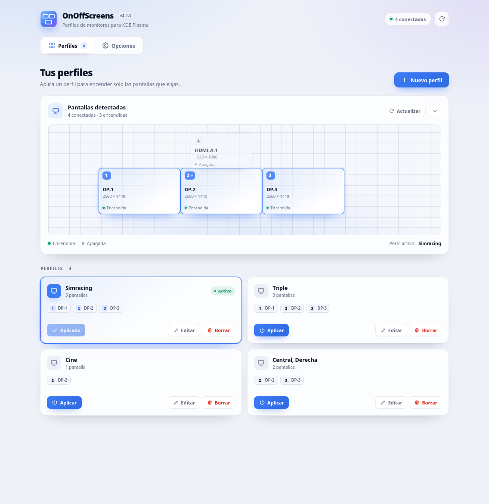

# OnOffScreens — display profiles for KDE Plasma

> Español: [LEEME.md](LEEME.md)

**OnOffScreens**, a **Rust + Tauri 2** desktop app to turn monitors on and off in groups
("profiles"). It detects the connected screens and their real layout, shows a
numbered interactive map, and applies profiles from a modern window or from the
system tray. Distributed as two **AppImages**: full and portable.

The original Python version is kept in [`legacy/`](legacy/) and its profiles are
imported automatically the first time.



---

## Features

- **Automatic detection** of screens and their actual position/size, with a
  numbered visual map so you can tell which screen is which at a glance.
- **Profiles stored by monitor UUID**, so they survive port changes, reboots
  and OS reinstalls. Select screens by clicking the map or the list.
- **Two-tab window**: *Profiles* and *Options*.
- **Create, edit, apply and delete** profiles in the window. The applied
  profile is highlighted with an *Active* badge.
- **System tray icon** with the profile list (active one checked), detected
  screens, a **Reconfigure displays** recovery action, KDE display settings and
  quit.
- **Start with the session** toggle in *Options*.
- **Tray icon embedded in the binary/AppImage**: no icon theme files required.
- **CLI** for scripts and keyboard shortcuts.
- **Spanish, Catalan and English**, detected from the system locale (Spanish
  variants in Spanish, Catalan variants in Catalan, English otherwise) or chosen
  in *Options → Language*.
- Stable EDID-based numbering and gapless re-packing when screens are turned
  off.

---

## Requirements

| What | Package |
|---|---|
| Desktop | **KDE Plasma 5.27+ / 6.x** (Wayland or X11) |
| Detection and apply | `kscreen` (`kscreen-doctor`) |
| UI runtime | `webkit2gtk-4.1`, `gtk3` (bundled in the full build; required by the portable build) |
| Tray | `libayatana-appindicator` (bundled in both AppImages) |
| Optional | `notify-send` for notifications |

The **full** build bundles the app, the UI (GTK and WebKitGTK) and the tray
libraries: it only depends on the system base libraries (glibc, graphics
drivers) and on `kscreen` inside KDE. The **portable/lightweight** build uses
the system GTK and WebKitGTK, bundles the tray stack, and is much smaller for
up-to-date systems. Both target **Arch, current Ubuntu LTS, Fedora** and
derivatives.

> KDE Plasma only, because it relies on `kscreen-doctor`. On other desktops
> (GNOME, niri, sway…) the window and settings open but there is no display
> backend.

---

## Using the AppImage

There are two versions:

| Version | Size | For |
|---|---|---|
| `OnOffScreens_2.1.0_amd64-full.AppImage` | ~78 MB | Any distro; bundles WebKitGTK and GTK |
| `OnOffScreens_2.1.0_amd64-portable.AppImage` | ~3.3 MB | Arch/CachyOS and up-to-date systems; uses system libraries |

The **portable** build needs `webkit2gtk-4.1` and `gtk3` installed:

```bash
# Arch / CachyOS
sudo pacman -S webkit2gtk-4.1 gtk3
# Ubuntu / Debian
sudo apt install libwebkit2gtk-4.1-0 libgtk-3-0
# Fedora
sudo dnf install webkit2gtk4.1 gtk3
```

Download the one you prefer, make it executable and run it:

```bash
chmod +x OnOffScreens_2.1.0_amd64-full.AppImage
./OnOffScreens_2.1.0_amd64-full.AppImage
```

- **Application menu**: use AppImageLauncher, Gearlever or create a launcher if
  you want integration. It is not required to run the app.
- **Autostart**: the *Options* toggle creates
  `~/.config/autostart/onoffscreens.desktop` pointing at the current AppImage
  path. If you move the AppImage, open it once and the entry is updated.
- **Tray at login**: with autostart and tray enabled, the app starts hidden and
  only shows the tray icon. Closing the window keeps it in the tray; use *Quit*
  from the tray menu to exit.
- **No FUSE** (Ubuntu 24.04 does not ship `libfuse2` by default): install
  `libfuse2t64` or run
  `./OnOffScreens_2.1.0_amd64-full.AppImage --appimage-extract-and-run`.

### Compatibility

Both AppImages are built on **Ubuntu 22.04** (glibc 2.35) so they also run on
Ubuntu 24.04, Arch, Fedora and derivatives. Building on a newer distro can
produce an AppImage that refuses to start on Ubuntu LTS; use the GitHub Actions
workflow or an Ubuntu 22.04 container for releases.

---

## Usage

### Window

1. **Profiles** shows the screen map, their state and your profiles.
2. **New profile** opens a popup with the layout; select screens, give it a name
   and save.
3. Every profile has **Apply**, **Edit** and **Delete**.
4. **Options** toggles autostart and the tray icon (enabled by default). It also
   lets you reconfigure the displays, reassign numbering, open KDE's display
   settings and the data folder.

### CLI

```bash
./OnOffScreens_2.1.0_amd64-full.AppImage                 # open the window
./OnOffScreens_2.1.0_amd64-full.AppImage --tray          # start in the tray only
./OnOffScreens_2.1.0_amd64-full.AppImage --list          # list profiles
./OnOffScreens_2.1.0_amd64-full.AppImage --apply "Cinema"# apply by name
./OnOffScreens_2.1.0_amd64-full.AppImage --apply 2       # apply by index
./OnOffScreens_2.1.0_amd64-full.AppImage --status        # detected screens
./OnOffScreens_2.1.0_amd64-full.AppImage --renumber      # recompute numbering
```

---

## Data and migration

| What | Where |
|---|---|
| Profiles | `~/.config/onoffscreens/perfiles.json` |
| Settings | `~/.config/onoffscreens/config.json` |
| Screen map | `~/.local/state/onoffscreens/mapa.json` |
| Autostart | `~/.config/autostart/onoffscreens.desktop` |

On first launch, if the old `~/.config/pantallas/perfiles.conf` exists it is
imported into `perfiles.json`; the `.conf` is left untouched. Numbers from the
old format are resolved through the stable map and converted to monitor UUIDs.

If you used the previous OnOffScreens build while it was still called
`pantallas`, `~/.config/pantallas` and `~/.local/state/pantallas` are copied to
`~/.config/onoffscreens` and `~/.local/state/onoffscreens` on first launch. The
original data is left untouched.

If the old version had autostart enabled (`pantallas-tray.desktop`), that
choice is preserved by creating the new entry and removing the old one. The old
menu launcher is not touched: if you installed it, remove it with
`pantallas-desinstalar`. If the old tray icon remains until you log out, stop
its process with `pkill -f "bin/pantallas tray"`.

### Profiles

Profiles are stored by **monitor UUID**, not by number or output name, so the
same profile works even if the monitor is plugged into another port.

- New screens get the next free number, assigned by position.
- Numbers survive reboots.
- **Reassign numbering** recomputes them from the current layout. Turn every
  screen on first.
- Applying a profile disables the unselected screens and re-packs the remaining
  ones **without gaps**, preserving rows (the top screen stays on top).

---

## Building

General requirements: Node.js 20+, stable Rust and the Tauri 2 system
dependencies.

**Arch / CachyOS**

```bash
sudo pacman -S --needed base-devel curl wget file openssl nodejs npm rust \
  webkit2gtk-4.1 gtk3 libayatana-appindicator librsvg
```

**Ubuntu 24.04**

```bash
sudo apt install build-essential curl wget file libssl-dev \
  libwebkit2gtk-4.1-dev libayatana-appindicator3-dev librsvg2-dev libxdo-dev patchelf
```

**Fedora**

```bash
sudo dnf install gcc-c++ make curl wget file openssl-devel \
  webkit2gtk4.1-devel libappindicator-gtk3-devel librsvg2-devel patchelf
```

Then:

```bash
npm install
npm run tauri dev       # development
npm run appimage        # full + portable AppImage in release/
```

To work on the UI without KDE, use the simulated backend (debug builds only):

```bash
ONOFFSCREENS_MOCK=1 npm run tauri dev
```

`npm run appimage` builds the full AppImage with Tauri and derives the portable
one with `scripts/package-appimages.sh`. Releases are built by
[`.github/workflows/build-appimage.yml`](.github/workflows/build-appimage.yml),
which generates both AppImages when a `v*` tag is pushed.

---

## Language

By default it follows the system locale (`ONOFFSCREENS_IDIOMA`, `LANGUAGE`,
`LC_ALL`, `LC_MESSAGES` or `LANG`): Spanish variants use Spanish, Catalan
variants use Catalan and anything else uses English. You can override it in
*Options → Language* (*Automatic*, *Spanish*, *Catalan*, *English*) or with an
environment variable:

```bash
ONOFFSCREENS_IDIOMA=ca ./OnOffScreens_2.1.0_amd64-full.AppImage
```

---

## Project layout

```
src/                  React + TypeScript UI
src-tauri/            Rust backend (kscreen, profiles, tray, autostart)
src-tauri/icons/      app and tray icons (embedded in the binary)
release/              full and portable AppImages + SHA-256
legacy/               original Python version + installers
.github/workflows/    AppImage build
CHANGELOG.md          version history
```

---

## Troubleshooting

- **No tray icon**: Plasma puts new icons in the hidden area (`^`). Right-click
  the tray → *Configure System Tray…* → *Entries* → *OnOffScreens* → *Always
  shown*.
- **“Screens could not be detected”**: install `kscreen` and check that
  `kscreen-doctor -j` works in your Plasma session.
- **The portable AppImage does not start**: install system `webkit2gtk-4.1` and
  `gtk3`, or use the full AppImage. Without FUSE use
  `--appimage-extract-and-run`.
- **Numbers look wrong after changing monitors**: turn all screens on and use
  *Options → Reassign numbering*.
- **A profile does not turn on a screen**: that screen is not connected.
  Profiles keep UUIDs, so the same monitor works again when reconnected.
- **Tray does not appear**: make sure `libayatana-appindicator` is installed and
  toggle the option off/on in *Options*.
- **Wrong colors or `Modeset failed` in the journal after logging in**: KDE is
  restoring an output setup with HDR and/or a high refresh rate; OnOffScreens
  does not change modes or HDR. Applying a profile forces a reconfiguration, which
  usually recovers the picture. If it happens on every login, lower the refresh
  rate or disable HDR for those outputs in KDE's display settings.

---

## License

**0BSD** — see [LICENSE](LICENSE). Use, modify and redistribute without
conditions.
