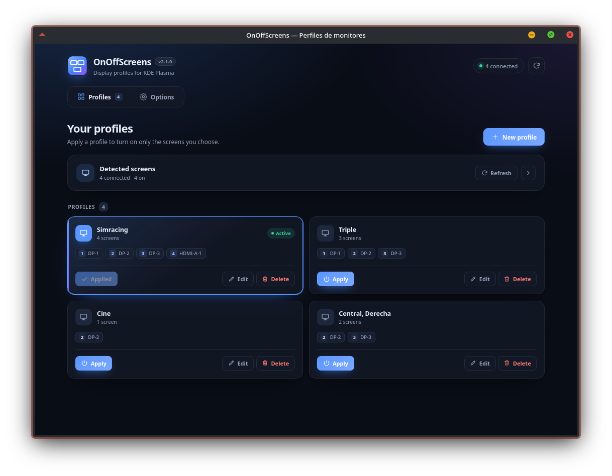
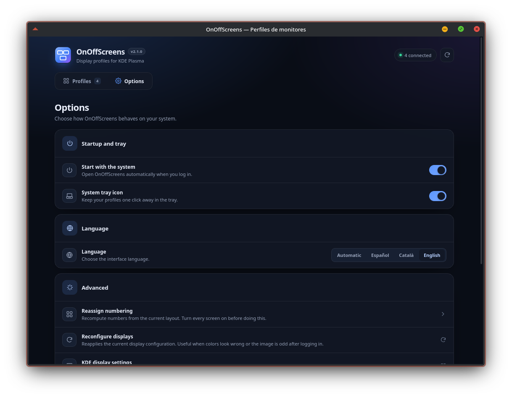
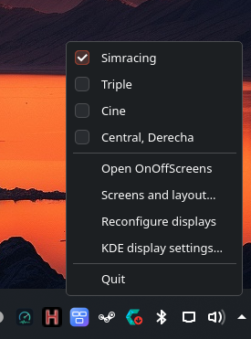

# OnOffScreens

**English** · [Español](README.es.md) · [Changelog](CHANGELOG.md)

[](https://github.com/pabeernosmatao/OnOffScreens/releases)
[](LICENSE)
[](#requirements)
[](https://tauri.app)
[](https://kde.org/plasma-desktop/)

> **Personal project — tested on KDE Plasma 6 (Wayland) with four screens.**
> OnOffScreens relies on KDE's `kscreen-doctor`. Other setups may work, but I can
> only test what I have. Bug reports and patches are welcome.

**Monitor profiles for KDE Plasma, from the window or the system tray.**

OnOffScreens is a small **Rust + Tauri 2** application distributed as an
**AppImage**. It detects your monitors, shows their real layout, and turns them on
or off in groups ("profiles") so you can switch between the profiles you have
created with one click — without unplugging cables.



*Profiles tab: detected screens, saved profiles and the active one highlighted.*

---

## What the AppImage does

- **Detects connected screens** and their real position and size through KDE's
  KScreen (`kscreen-doctor`), and draws a numbered map so you can tell which
  monitor is which at a glance.
- **Stores profiles by monitor UUID**, not by port or name, so a profile keeps
  working if you move a cable or reinstall the system.
- **Turns screens on and off by profile.** Screens that are not selected are
  disabled and the remaining ones are re-packed without gaps, preserving rows.
- **Window, system tray and CLI** for the same profiles. The tray menu marks the
  last applied profile and can apply any other.
- **Autostart with the session**, starting hidden in the tray if you want.
- **Reconfigure displays** recovery action for when KDE comes up with wrong
  colors or an odd picture after login.
- **Spanish, Catalan and English**, automatic or selectable.
- **Single-file AppImage:** no installation and no root. Profiles and settings
  stay in your home directory.
- **No telemetry, no accounts, no network access.**

> OnOffScreens does **not** choose resolutions, refresh rates, scale, rotation or
> HDR. It only enables/disables outputs and moves them; KDE keeps the display
> settings you configured in Plasma.

## KDE Plasma only

OnOffScreens talks to **KDE Plasma** through `kscreen-doctor`, from the `kscreen`
package. It requires **KDE Plasma 5.27+ or 6.x**, on Wayland or X11.

On GNOME, XFCE, sway, niri and similar desktops the window opens, but there is no
display backend: it cannot detect or apply profiles. It is not available for
Windows or macOS.

The tray icon uses StatusNotifierItem/AppIndicator. Plasma supports it natively;
on other desktops you need a compatible tray (for example GNOME with the
AppIndicator extension).

## Screenshots

### Create and edit profiles


*Choose the screens to turn on by clicking the map or the list.*

### Options



*Autostart, tray, language, reconfigure displays and advanced actions.*

### System tray



*The tray keeps every profile one click away, including the recovery action.*

## Download and run

Download the latest AppImage from
[Releases](https://github.com/pabeernosmatao/OnOffScreens/releases/latest), make it
executable and run it:

```bash
chmod +x OnOffScreens_2.1.0_amd64-full.AppImage
./OnOffScreens_2.1.0_amd64-full.AppImage
```

Two builds are published, both **x86_64**:

| Build | Size | Libraries | Recommended for |
|---|---|---|---|
| `OnOffScreens_2.1.0_amd64-full.AppImage` | ~80 MB | Bundles GTK, WebKitGTK and the tray stack | Any distro; the safe choice |
| `OnOffScreens_2.1.0_amd64-portable.AppImage` | ~3.3 MB | Uses system GTK/WebKitGTK; bundles the tray stack | Arch/CachyOS and up-to-date systems |

Official releases are built on **Ubuntu 22.04**, so they need at most **glibc
2.35**. If you build the AppImages locally on a newer distro, they may not start
on older systems.

The portable build needs `webkit2gtk-4.1` and `gtk3`:

```bash
# Arch / CachyOS
sudo pacman -S webkit2gtk-4.1 gtk3

# Ubuntu / Debian
sudo apt install libwebkit2gtk-4.1-0 libgtk-3-0

# Fedora
sudo dnf install webkit2gtk4.1 gtk3
```

If your system has no FUSE2 (Ubuntu 24.04 by default):

```bash
sudo apt install libfuse2t64
# or
./OnOffScreens_2.1.0_amd64-full.AppImage --appimage-extract-and-run
```

AppImageLauncher, Gearlever and similar tools are optional; they only integrate
the AppImage into the application menu.

Verify the download:

```bash
sha256sum -c OnOffScreens_2.1.0_amd64-full.AppImage.sha256
```

## Requirements

| What | Needed for |
|---|---|
| **KDE Plasma 5.27+ / 6.x** with `kscreen` | Detecting and applying profiles |
| Linux **x86_64**, glibc 2.35+ | Running the official AppImages |
| `webkit2gtk-4.1` and `gtk3` | Only the portable build |
| StatusNotifierItem/AppIndicator tray | The tray icon (native in Plasma) |
| `notify-send` (optional) | Desktop notifications |
| `libayatana-appindicator` | Bundled in both AppImages |

No root access is required to run OnOffScreens.

## Using it

### Window

1. **Profiles** shows the detected screens, their layout and your profiles.
2. **New profile** opens the layout editor; select the screens to turn on, name
   the profile and save it.
3. Every profile has **Apply**, **Edit** and **Delete**. The active one is
   highlighted with an **Active** badge.
4. **Options** controls autostart, the tray icon, the language, reconfigure
   displays, numbering, KDE display settings and the configuration folder.

Applying a profile:
- Turns on the screens in the profile.
- Turns off the connected screens that are not in it.
- Repositions the remaining screens without gaps, keeping rows.

Only the changes that are actually needed are sent to KDE. Applying a profile
that already matches the current layout does not reconfigure the displays again.

### System tray

The tray menu contains:

- Your profiles, with the last applied one checked.
- **Open OnOffScreens**.
- **Screens and layout…**.
- **Reconfigure displays**.
- **KDE display settings…**.
- **Quit**.

If the tray icon is enabled, closing the window keeps OnOffScreens running in the
tray. Use **Quit** to exit.

### Reconfigure displays

Use **Options → Advanced → Reconfigure displays** (or the tray entry) when the
picture or the colors look wrong after logging in. It asks KDE to reapply the
current enabled outputs. The screen may flicker for a moment; it does not change
your active profile.

This is the quickest recovery when KDE starts with an HDR/high-refresh setup that
did not apply correctly. If it happens on every login, lower the refresh rate or
disable HDR for those outputs in KDE's display settings.

### Start with the session

Enable **Start with the system** in *Options*. The entry is created in
`~/.config/autostart/onoffscreens.desktop` and points at the current AppImage. If
you move the AppImage, open it once and the path is updated automatically.

With autostart and tray enabled, the app starts hidden and only the tray icon
appears. No display queries are made while it stays in the tray; the state is read
when you open the window or run an action.

### CLI

```bash
./OnOffScreens_2.1.0_amd64-full.AppImage                 # open the window
./OnOffScreens_2.1.0_amd64-full.AppImage --tray          # start in the tray only
./OnOffScreens_2.1.0_amd64-full.AppImage --list          # list profiles
./OnOffScreens_2.1.0_amd64-full.AppImage --apply "Work"  # apply by name
./OnOffScreens_2.1.0_amd64-full.AppImage --apply 2       # apply by index
./OnOffScreens_2.1.0_amd64-full.AppImage --status        # detected screens
./OnOffScreens_2.1.0_amd64-full.AppImage --renumber      # recompute numbering
```

## Profiles and data

Profiles are stored by **monitor UUID**, so the same profile works when a monitor
changes port. New screens receive the next free number by position; numbers
survive reboots.

**Reassign numbering** recomputes the numbers from the current layout. Turn every
screen on before using it.

| What | Where |
|---|---|
| Profiles | `~/.config/onoffscreens/perfiles.json` |
| Settings | `~/.config/onoffscreens/config.json` |
| Screen map | `~/.local/state/onoffscreens/mapa.json` |
| Autostart | `~/.config/autostart/onoffscreens.desktop` |

If you used the old Python version (or the previous `pantallas` name), its data is
migrated on first launch and the original files are left untouched.

## Languages

The interface is available in **Spanish, Catalan and English**.

- **Automatic** follows the system locale: Spanish variants (`es_*`) use Spanish,
  Catalan variants (`ca_*`) use Catalan and everything else uses English.
- You can force a language in **Options → Language**.
- For scripts or tests, `ONOFFSCREENS_IDIOMA` still overrides the locale:

```bash
ONOFFSCREENS_IDIOMA=ca ./OnOffScreens_2.1.0_amd64-full.AppImage
```

## Troubleshooting

- **No tray icon:** Plasma puts new icons in the hidden area (`^`). Right-click
  the tray → *Configure System Tray…* → *Entries* → *OnOffScreens* → *Always
  shown*.
- **“Screens could not be detected”:** install `kscreen` and check that
  `kscreen-doctor -j` works in your Plasma session.
- **The portable AppImage does not start:** install `webkit2gtk-4.1` and `gtk3`,
  or use the full build. Without FUSE use `--appimage-extract-and-run`.
- **Numbers do not match after changing monitors:** turn every screen on and use
  *Options → Reassign numbering*.
- **A profile does not turn on a screen:** that screen is not connected. Profiles
  keep UUIDs, so it works again when the monitor is reconnected.
- **Wrong colors or `Modeset failed` in the journal after login:** KDE is
  restoring an output setup with HDR and/or a high refresh rate; OnOffScreens does
  not change modes or HDR. Use **Reconfigure displays** to force a reapply. If it
  repeats, lower the refresh rate or disable HDR for those outputs in KDE.
- **KWin freezes when changing profiles:** 2.1 sends only the changes that are
  needed instead of re-enabling every screen. If it still happens, the freeze is
  in KDE/KWin; the recovery action and the journal lines from the app help
  diagnose it.

Bugs and feature requests:
[github.com/pabeernosmatao/OnOffScreens/issues](https://github.com/pabeernosmatao/OnOffScreens/issues).

## Building

General requirements: **Node.js 20+**, stable **Rust** and the Tauri 2 system
dependencies.

**Arch / CachyOS**

```bash
sudo pacman -S --needed base-devel curl wget file openssl nodejs npm rust \
  webkit2gtk-4.1 gtk3 libayatana-appindicator librsvg
```

**Ubuntu 24.04**

```bash
sudo apt install build-essential curl wget file libssl-dev \
  libwebkit2gtk-4.1-dev libayatana-appindicator3-dev librsvg2-dev libxdo-dev patchelf
```

**Fedora**

```bash
sudo dnf install gcc-c++ make curl wget file openssl-devel \
  webkit2gtk4.1-devel libappindicator-gtk3-devel librsvg2-devel patchelf
```

Then:

```bash
npm install
npm run tauri dev       # development
npm run appimage        # full + portable AppImage in release/
```

To work on the UI without KDE, use the simulated backend (debug builds only):

```bash
ONOFFSCREENS_MOCK=1 npm run tauri dev
```

`npm run appimage` builds the full AppImage with Tauri and derives the portable
one with [`scripts/package-appimages.sh`](scripts/package-appimages.sh). The
[GitHub Actions workflow](.github/workflows/build-appimage.yml) builds both on
Ubuntu 22.04 and publishes a release when a `v*` tag is pushed.

### Project layout

```text
src/                  React + TypeScript UI
src-tauri/            Rust backend (kscreen, profiles, tray, autostart)
src-tauri/icons/      app and tray icons (embedded in the binary)
scripts/              portable AppImage packaging
release/              release notes (AppImages are published as GitHub releases)
legacy/               original Python version + installers
docs/                 screenshots and documentation
.github/workflows/    AppImage build
CHANGELOG.md          version history
```

## Contributing

This is a personal project, but bug reports and pull requests are welcome. Issues
and PRs can be written in **English or Spanish**. Please include your distro,
Plasma/KDE version, `kscreen-doctor --version`, and the output of
`kscreen-doctor -j` when reporting a display problem.

## License

OnOffScreens is **MIT** — see [LICENSE](LICENSE).
